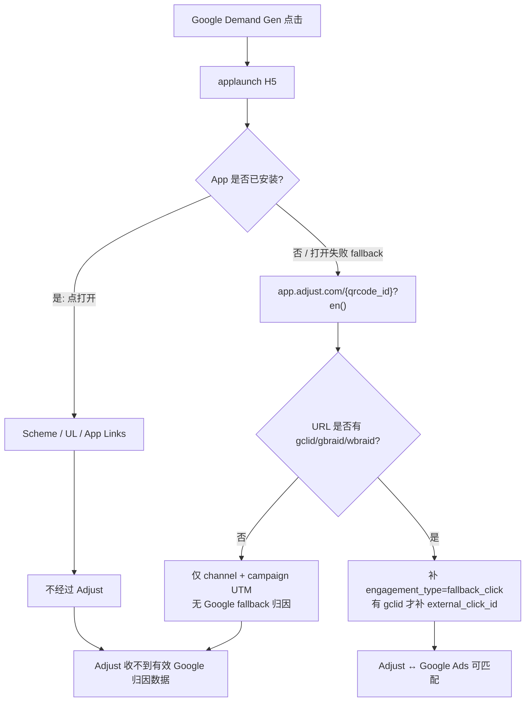

# Google Demand Gen → Adjust 收不到数据：根因分析

## 结论

这条 Demand Gen 落地页链接 **缺少 Google 点击标识（`gclid` / `gbraid` / `wbraid`）和 ValueTrack 参数**。  
页面 JS 因此 **不会** 给 Adjust 链接补上 Google web-to-app 归因所需的 `engagement_type=fallback_click` / `external_click_id`，Adjust 无法按 Google Ads 完成点击匹配。

另外还有两个加重问题：

1. 代码里 `external_click_id` **只透传 `gclid`**，有 `gbraid`/`wbraid` 时也不写（Demand Gen / iOS 很常见）。
2. 已安装用户点「打开」走 Scheme / Universal Link，**不经过** `app.adjust.com`，re-engagement 数据进不了 Adjust。

---

## 分析的链接

```
https://m.mykeeta.com/marketing/applaunch/index.html
  ?openType=appLaunch
  &locale=ar
  &region=SA
  &bizline=2
  &qrcode_id=22v2dovr
  &url_id=1953756815569211472
  &utm_source=marketing
  &utm_medium=google
  &utm_campaign=googleadsdemandgen
  &inner_url=sailorc://www.keeta-global.com/marketTransfer/osg/machpro?...
```

线上包：`com.sankuai.sailorfe.openapp` → `common-link-page/js/main.*.js`

---

## 页面归因链路



下载链接由 `qrcode_id` 拼 Adjust tracker：

```text
https://app.adjust.com/{qrcode_id}?{en()}&redirect={AppStore|Play|Huawei}
```

对本链接即：`https://app.adjust.com/22v2dovr?...`

---

## 关键代码逻辑（`en()`）

### 1) 基础参数：只映射 UTM + 点击 ID 原样透传

```js
function en() {
  var e = getUrlParams(), t = [];
  e.utm_source && t.push("channel=" + encodeURIComponent(e.utm_source));
  e.utm_campaign && t.push("campaign=" + encodeURIComponent(e.utm_campaign));
  e.utm_content && t.push("adgroup=" + encodeURIComponent(e.utm_content));
  e.utm_term && t.push("creative=" + encodeURIComponent(e.utm_term));

  ["fbclid","fbpid","gclid","gbraid","wbraid","ScCid","ttclid","sccid"]
    .forEach(function (r) {
      e[r] && t.push(r + "=" + encodeURIComponent(e[r]));
    });

  // ... Snap / TikTok / Google 增强 ...
}
```

对本链接最终只会得到：

```text
channel=marketing
&campaign=googleadsdemandgen
&deep_link=sailorc://...
```

**没有** Google Ads 归因关键字段。

### 2) Google 增强：必须先有点击 ID

```js
function Zt() {
  return Yt.gclid || Yt.wbraid || Yt.gbraid;
}

// Google 分支
if (!Zt()) return t; // ← 本链接直接 return，后面全部跳过

t.push("engagement_type=fallback_click");

// 注意：只对 gclid 写 external_click_id
e.gclid && t.push("external_click_id=" + e.gclid);

// 还依赖 ValueTrack：campaignid / adgroupid / creative / network ...
```

本链接 `Zt() === false`，因此：

| 期望字段 | 实际 |
|---|---|
| `engagement_type=fallback_click` | 缺失 |
| `external_click_id` | 缺失 |
| `gclid` / `gbraid` / `wbraid` | 缺失 |
| `campaignid` / `adgroupid` / `creative` | 缺失 |

### 3) 代码缺陷：`gbraid` / `wbraid` 未映射 `external_click_id`

Demand Gen（YouTube / Discover / Gmail）和 iOS 流量经常只有 `gbraid`/`wbraid`。  
即使落地页带上了这两个参数，当前实现也 **不会** 写入 `external_click_id=...`，Google ↔ Adjust 匹配仍可能失败。

---

## 投放侧配置问题

当前 Final URL 只手写了 UTM：

```text
utm_source=marketing
utm_medium=google
utm_campaign=googleadsdemandgen
```

建议同时确认：

1. **Google Ads Auto-tagging 已开启**（点击后自动追加 `gclid` / `gbraid` / `wbraid`）。
2. Final URL / Final URL suffix 增加 ValueTrack，例如：

```text
campaignid={campaignid}
&adgroupid={adgroupid}
&creative={creative}
&network={network}
&utm_placement={placement}
```

3. 中间没有跳转把 `gclid`/`gbraid`/`wbraid` 丢掉。
4. 用真实广告点击（不要只测静态 Final URL）检查落地页地址栏是否出现点击 ID。

> 说明：你贴出的是配置用 Final URL，本身不会带 click id；**真实点击后**必须能看到。若真实点击后仍没有，优先查 auto-tagging / 跳转丢参。

---

## 「打开 App」路径不进 Adjust

已安装用户：

```js
an() → rn.openScheme(...)  // Scheme / UL / App Links
```

只有打开失败 timeout 后才会 `fallTo*` → `app.adjust.com`。

因此大量 Demand Gen 带来的 **已安装唤醒** 不会产生 Adjust click，表现为 Adjust「没数据」或只有极少下载归因。

若需要 re-engagement 进 Adjust，打开链路也要经过 Adjust（或 SDK 从 deeplink 解析 click id 上报）。

---

## 修复建议（按优先级）

### A. 投放（立刻可验证）

1. 确认 Auto-tagging。
2. Final URL suffix 补 ValueTrack（`campaignid` 等）。
3. 真实点击验证落地页与后续 Adjust URL 是否包含：
   - `gclid` 或 `gbraid`/`wbraid`
   - `engagement_type=fallback_click`
   - `external_click_id=...`（至少 gclid）

### B. 前端代码（`common-link-page`）

1. `external_click_id` 支持 `gclid || gbraid || wbraid`（互斥取一个）。
2. 打开 App 路径也携带 click id / 走 Adjust 再 deeplink（视产品策略）。
3. 对 `utm_medium=google` 且无 click id 的流量打监控告警，便于发现配置问题。

### C. Adjust / Google 后台

1. Adjust 已对接 Google Ads，且该 app 开启对应 campaign type。
2. Demand Gen 走的是 **web landing → Adjust link** 的 fallback 路径，不是 Google SAN 自动点记；必须依赖 click id 透传。

---

## 一句话复现

用当前静态链接打开页面后点下载，生成的 Adjust URL 形如：

```text
https://app.adjust.com/22v2dovr
  ?channel=marketing
  &campaign=googleadsdemandgen
  &deep_link=...
  &redirect=https://play.google.com/...
```

对比正常 Google web-to-app 应类似：

```text
https://app.adjust.com/22v2dovr
  ?channel=...
  &campaign=googleadsdemandgen%20(123456789)
  &gclid=XXXX
  &external_click_id=XXXX
  &engagement_type=fallback_click
  &adgroup=...
  &creative=...
  &deep_link=...
```

缺少后半段，就是 Adjust 收不到 Google Demand Gen 归因数据的直接原因。
